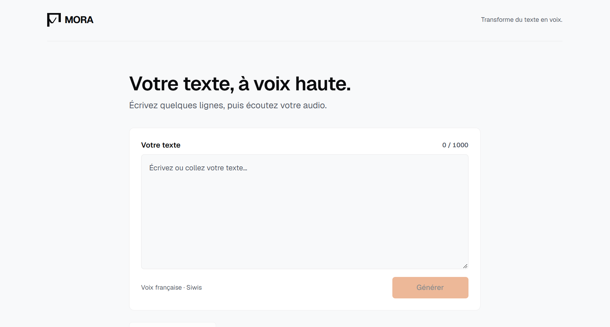
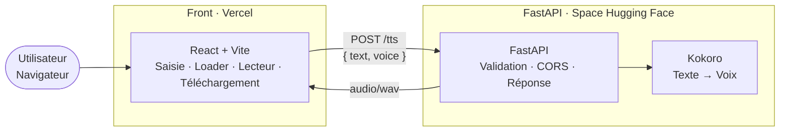

<div align="center">

[English](README.md) · [**Français**](README.fr.md)

<h1> MORA</h1>

### Transformez du texte en voix, dans votre navigateur.

Collez un texte. Générez une voix naturelle. Écoutez-la instantanément. Téléchargez-la en WAV.<br/>
Une application IA full-stack open source : front React, API d'inférence FastAPI et modèle TTS Kokoro. Le front est déployé sur Vercel et l'API sur un Space Hugging Face.

[](LICENSE)
[](#feuille-de-route)
[](#déploiement)
[](https://react.dev)
[](https://fastapi.tiangolo.com)
[](https://huggingface.co/hexgrad/Kokoro-82M)

**Déployé** · [https://mora-chi.vercel.app/](https://mora-chi.vercel.app/) · [Space API Hugging Face](https://huggingface.co/spaces/iamSAVITAR/mora) · [**Démarrage rapide**](#démarrage-rapide) · [**Référence API**](#référence-api) · [**Feuille de route**](#feuille-de-route) · [**Contribuer**](#contribuer)

<br/>



</div>

<br/>

> [!NOTE]
> Le front est déployé sur Vercel et l'API sur un Space Hugging Face.

---

## Table des matières

- [Présentation](#présentation)
- [Fonctionnalités](#fonctionnalités)
- [Démarrage rapide](#démarrage-rapide)
- [Architecture](#architecture)
- [Stack technique](#stack-technique)
- [Installation](#installation)
- [Configuration](#configuration)
- [Utilisation](#utilisation)
- [Référence API](#référence-api)
- [Structure du projet](#structure-du-projet)
- [Déploiement](#déploiement)
- [Sécurité](#sécurité)
- [Performance](#performance)
- [Tests](#tests)
- [Décisions techniques](#décisions-techniques)
- [Feuille de route](#feuille-de-route)
- [Contribuer](#contribuer)
- [FAQ](#faq)
- [Support](#support)
- [Licence](#licence)
- [Remerciements](#remerciements)

---

## Présentation

La plupart des démos TTS s'arrêtent à un script Python. MORA livre **toute la chaîne** : cadrage produit, choix du modèle, API d'inférence isolée et front end.

Le projet est volontairement petit, abouti et honnête sur ses limites. Ce n'est pas un clone d'ElevenLabs : c'est une implémentation de référence pour **servir un modèle open source derrière un contrat propre** et lui associer une vraie interface.

> *En tant que visiteur, je veux coller un texte en français, générer une voix, l'écouter et la télécharger, sans créer de compte.*

| | |
|---|---|
| **Sans compte** | Ouvrez la page et générez. Pas d'inscription, pas de clé d'API. |
| **Sans entraînement** | Utilise un checkpoint open source déjà évalué plutôt qu'un entraînement from scratch. |
| **Sans verrouillage** | Front et API sont découplés. Le front peut pointer vers une autre API via `VITE_API_URL`. |
| **Sans coût** | Le projet est déployé sur Vercel et Hugging Face Spaces. |

---

## Fonctionnalités

| Capacité | Détails |
|---|---|
| **Interface en français** | UI entièrement en français, centrée sur un parcours unique |
| **Synthèse vocale** | Modèle open source Kokoro, inférence CPU, aucun entraînement maison |
| **Voix française** | L'API prend en charge `ff_siwis` |
| **Pré-écoute instantanée** | Lecteur `<audio>` natif, lecture dans le navigateur |
| **Téléchargement en un clic** | Export du résultat au format WAV |
| **Garde-fous de saisie** | Longueur maximale du texte imposée côté serveur pour protéger la latence et le CPU |
| **Retours clairs** | État de chargement pendant l'inférence et messages d'erreur explicites |
| **Architecture découplée** | Le front React et FastAPI communiquent via un seul endpoint |

### Parcours utilisateur

1. Saisir ou coller un texte.
2. Cliquer sur **Générer**.
3. Patienter pendant l'inférence.
4. Écouter le résultat dans le navigateur.
5. Télécharger le fichier audio.

<div align="center">


</div>

---

## Démarrage rapide

Lancez toute la stack en local sous Windows.

```powershell
git clone https://github.com/iamydgel/mora.git
cd mora
```

**Terminal 1 : API**

```powershell
cd api
python -m venv .venv
.\.venv\Scripts\Activate.ps1
python -m pip install -r requirements.txt
uvicorn app.main:app --reload --host 127.0.0.1 --port 8000
```

**Terminal 2 : Front**

```powershell
cd frontend
Copy-Item .env.example .env # VITE_API_URL=http://127.0.0.1:8000
npm install
npm run dev
```

Ouvrez l'URL affichée par Vite (par défaut `http://localhost:5173`), saisissez un texte et cliquez sur **Générer**.

---

## Architecture



| Couche | Responsabilité | Où ça tourne |
|---|---|---|
| **Front** | UX, appels HTTP, lecture, téléchargement | Vercel (et serveur de développement local) |
| **API** | Validation, orchestration de l'inférence, format de réponse, CORS | Space Hugging Face (et serveur Uvicorn local) |
| **Modèle** | Texte → parole | Chargé par l'API |
| **Auth / paiement / stockage objet** | Hors MVP | n/a |

Le front et l'API partagent **un contrat unique** : `POST /tts`. Pointer le front vers une autre API revient à changer `VITE_API_URL`, pas à recoder le produit.

<div align="center">


</div>

---

## Stack technique

| Couche | Technologie | Pourquoi |
|---|---|---|
| Front | [React](https://react.dev) + [Vite](https://vitejs.dev) | Standard de l'industrie, boucle de feedback rapide, lisible |
| HTTP | `fetch` + `Blob` | Suffisant pour un flux POST puis lecture binaire |
| API | [FastAPI](https://fastapi.tiangolo.com) | Typage, documentation OpenAPI native, écosystème ML Python |
| Modèle | [Kokoro](https://huggingface.co/hexgrad/Kokoro-82M) | Open source, excellent rapport qualité / taille, réaliste sur CPU |

---

## Installation

### Prérequis

| Outil | Version | Notes |
|---|---|---|
| Node.js | 20+ | Front |
| Python | 3.10+ | API |
| espeak-ng | dernière | Dépendance du phonémiseur utilisée par Kokoro pour le texte non anglais (`apt-get install espeak-ng`, `brew install espeak-ng`) |

### API

```powershell
cd api
python -m venv .venv
.\.venv\Scripts\Activate.ps1
pip install -r requirements.txt
uvicorn app.main:app --reload --host 127.0.0.1 --port 8000
```

La documentation OpenAPI interactive est servie par FastAPI sur `http://localhost:8000/docs`.

### Front

```powershell
cd frontend
Copy-Item .env.example .env
npm install
npm run dev
```

### API avec Docker

`api/Dockerfile` est présent, mais le Space Hugging Face utilise actuellement le SDK Gradio plutôt que Docker.

---

## Configuration

Le front communique avec l'API uniquement via `VITE_API_URL`. Aucune URL n'est codée en dur.

### Variables d'environnement

#### Front (`frontend/.env`)

| Variable | Requise | Exemple | Description |
|---|---|---|---|
| `VITE_API_URL` | Oui | `http://127.0.0.1:8000` | URL de base de l'API MORA, sans slash final |

#### API (`api/.env`)

| Variable | Requise | Défaut | Description |
|---|---|---|---|
| `ALLOWED_ORIGINS` | Non | `http://localhost:5173,http://127.0.0.1:5173` | Origines CORS séparées par des virgules, lues dans l'environnement du processus ; l'API ne charge pas `api/.env` |

### Configuration avancée

- **Valeurs de l'API.** Le checkpoint, le code langue, la voix prise en charge et la limite de texte sont définis dans `api/app/main.py` ; les origines CORS peuvent être remplacées avec `ALLOWED_ORIGINS`.
- **Timeout client.** Le timeout de requête côté front est de 120 secondes pour laisser le temps à l'inférence.
- **Variables à la compilation.** Vite lit les valeurs `VITE_*` au démarrage ou au build. Redémarrez Vite après tout changement de `VITE_API_URL`.
- **Changement de backend.** Tout serveur implémentant le contrat [`POST /tts`](#référence-api) peut remplacer l'API locale sans toucher au front.

---

## Utilisation

### Depuis l'interface web

1. Collez un texte en français dans le champ de saisie.
2. Cliquez sur **Générer** et attendez la fin du chargement.
3. Lancez la lecture, puis téléchargez le fichier WAV.

### Depuis la ligne de commande

```powershell
curl.exe -X POST http://127.0.0.1:8000/tts -H "Content-Type: application/json" -d '{"text":"Bonjour, ceci est un test de synthèse vocale.","voice":"ff_siwis"}' --output mora.wav
```

### Depuis JavaScript

```js
const response = await fetch(`${import.meta.env.VITE_API_URL}/tts`, {
  method: "POST",
  headers: { "Content-Type": "application/json" },
  body: JSON.stringify({
    text: "Bonjour, ceci est un test de synthèse vocale.",
    voice: "ff_siwis",
  }),
});

if (!response.ok) throw new Error(`Échec de la requête TTS (${response.status})`);

const audioUrl = URL.createObjectURL(await response.blob());
new Audio(audioUrl).play();
```

---

## Référence API

### `GET /health`

Renvoie `{"status":"ok"}` lorsque l'API est en fonctionnement.

### `POST /tts`

Synthétise la parole à partir d'un texte et renvoie un fichier WAV.

**Requête**

```http
POST /tts
Content-Type: application/json
```

```json
{
  "text": "Bonjour, ceci est un test de synthèse vocale.",
  "voice": "ff_siwis"
}
```

| Champ | Type | Requis | Règles |
|---|---|---|---|
| `text` | `string` | Oui | Non vide après suppression des espaces de début et de fin, et limité à 1000 caractères après cette suppression |
| `voice` | `string` | Non | Seule `ff_siwis` est prise en charge ; valeur par défaut si omise |

**Réponse**

| Statut | Type de contenu | Signification |
|---|---|---|
| `200 OK` | `audio/wav` | Audio WAV binaire à 24 kHz avec `Content-Disposition: attachment; filename="mora.wav"` |
| `400 Bad Request` | `application/json` | Texte vide, texte trop long ou voix inconnue |
| `422 Unprocessable Entity` | `application/json` | Champs de requête manquants ou invalides |
| `500 Internal Server Error` | `application/json` | Échec d'inférence ou d'encodage WAV |

Les corps d'erreur suivent l'enveloppe standard de FastAPI : `{ "detail": "..." }`.

**CORS.** L'API autorise `http://localhost:5173` et `http://127.0.0.1:5173`.

> [!IMPORTANT]
> L'API charge `hexgrad/Kokoro-82M` avec le code langue français (`f`) au démarrage. La seule voix prise en charge est `ff_siwis`.

---

## Structure du projet

```text
mora/
├── README.md
├── README.fr.md
├── LICENSE
├── frontend/                 # Application React + Vite
│   ├── src/
│   ├── package.json
│   └── .env.example
├── api/                      # Service d'inférence FastAPI + Kokoro
│   ├── app/
│   ├── test_kokoro.py
│   ├── requirements.txt
│   └── .venv/                 # Environnement virtuel local, ignoré par Git
└── docs/
    ├── scs1.png
    ├── demo.gif
    └── architecture.png
```

Un seul dépôt simplifie le clonage, la relecture et le lien avec le portfolio.

---

## Déploiement

Le front est déployé sur [Vercel](https://mora-chi.vercel.app) et l'API sur le [Space Hugging Face](https://huggingface.co/spaces/iamSAVITAR/mora).

### 1. API : Space Hugging Face (SDK Gradio)

Le Space utilise le SDK Gradio sur le matériel ZeroGPU. Son interface Gradio est montée sur l'application FastAPI, qui expose les endpoints documentés `/health` et `/tts`.

### 2. Front : Vercel

Le front est déployé à l'adresse [mora-chi.vercel.app](https://mora-chi.vercel.app).

> [!WARNING]
> Le chemin de l'image d'architecture dans la structure du projet est un placeholder ; `docs/architecture.png` est absent.

---

## Sécurité

| Domaine | Mesure |
|---|---|
| **Validation des entrées** | Présence et longueur maximale du texte vérifiées avant l'inférence |
| **Liste blanche de voix** | Seule une liste fermée de voix est acceptée ; toute valeur inconnue renvoie `400` |
| **CORS** | Liste explicite : `http://localhost:5173` et `http://127.0.0.1:5173` |
| **API sans état** | Pas de comptes, pas de base de données, pas de stockage objet : rien à divulguer |
| **Secrets** | Aucune clé d'API n'est requise. L'URL de l'API du front utilise `VITE_API_URL` ; l'API lit `ALLOWED_ORIGINS` dans l'environnement du processus |
| **Résistance aux abus** | La limite de texte est le seul garde-fou côté requête ; aucun quota ni limite de débit n'est implémenté |

---

## Performance

MORA exécute l'inférence sur **CPU** par conception.

| Facteur | Comportement |
|---|---|
| **Latence** | Croît avec la longueur du texte. Rapide sur les textes courts, plus lente qu'un GPU sur les textes longs |
| **Démarrage** | L'API locale charge le pipeline Kokoro une fois au démarrage de l'application |
| **Taille des fichiers** | Le WAV n'est pas compressé : les fichiers sont plus lourds qu'en MP3 ou Opus |
| **Atténuations** | Plafond de longueur côté serveur, timeout client généreux, état de chargement explicite |

L'API est également déployée sur un Space Hugging Face avec le SDK Gradio et du matériel ZeroGPU.

---

## Tests

MORA peut être testé en local via son contrat API unique.

Depuis `api/`, lancez `python test_kokoro.py` pour générer `sortie.wav` avec le test Kokoro.

**Test de fumée de l'API**

```powershell
curl.exe -s -o mora.wav -w "%{http_code} %{content_type}" -X POST http://127.0.0.1:8000/tts -H "Content-Type: application/json" -d '{"text":"Bonjour","voice":"ff_siwis"}'
# Attendu : 200 audio/wav
```

**Vérifier les garde-fous**

```powershell
# Texte vide → 400
curl.exe -s -o NUL -w "%{http_code}" -X POST http://127.0.0.1:8000/tts -H "Content-Type: application/json" -d '{"text":""}'

# Voix inconnue → 400
curl.exe -s -o NUL -w "%{http_code}" -X POST http://127.0.0.1:8000/tts -H "Content-Type: application/json" -d '{"text":"Bonjour","voice":"unknown"}'
```

**Front**

Lancez `npm run dev`, puis vérifiez le loader, le lecteur, le téléchargement et les messages d'erreur pour une saisie vide ou trop longue.

Les tests automatisés de l'API et la CI figurent dans la [feuille de route](#feuille-de-route).

---

## Décisions techniques

| Décision | Raison |
|---|---|
| **Un parcours fini plutôt que de nombreuses fonctionnalités inachevées** | Texte → audio → écoute → téléchargement, livré de bout en bout, vaut mieux que huit fonctionnalités à 40 % |
| **Modèle open source plutôt qu'une API commerciale** | L'objectif est d'apprendre à *servir* un modèle, pas seulement à consommer une clé |
| **Pas d'entraînement** | Temps, GPU et qualité de dataset hors budget et hors objectif. La valeur est dans l'intégration : serving, contrat API, UI, déploiement |
| **FastAPI au plus près du modèle** | L'inférence Python reste proche des poids |
| **Monorepo** | Le front, l'API et la documentation partagent un seul dossier de projet |
| **Contrat à endpoint unique** | Le front et l'API restent découplés autour de la requête de génération |

### Hors périmètre dans cette version

- Comptes, authentification, JWT
- Paiement, Stripe, quotas
- Historique cloud (stockage objet + base de données)
- Clonage vocal (XTTS, OpenVoice, etc.)
- GPU, EC2, VPS payant, nom de domaine payant

Ce sont des frontières volontaires, pas des oublis. Elles restent des pistes d'évolution. La ligne d'arrivée était un **produit démontrable**, pas le début d'un mini-SaaS.

### Limites assumées

- L'API prend uniquement en charge la voix française `ff_siwis` sur `hexgrad/Kokoro-82M`.
- La qualité vocale est celle de Kokoro, pas d'un service commercial.
- Pas d'historique cloud ni de comptes utilisateurs.
- Usage pédagogique et démonstration, sans SLA de production.

---

## Feuille de route

**MVP**

- [x] Cadrage produit, architecture, stack à 0 €
- [x] Kokoro + FastAPI en local
- [x] Front React minimal (saisie, loader, lecteur, téléchargement)
- [x] Monorepo GitHub et documentation
- [x] Déploiement Space Hugging Face (SDK Gradio sur ZeroGPU) et Vercel
- [x] Captures d'écran, GIF de démo, liens live

**Ensuite** *(toujours à 0 € si possible)*

- [ ] 2 à 3 voix clairement exposées dans l'UI
- [ ] Historique via `localStorage`
- [ ] Mini landing page dans la même application React
- [ ] Logique de retry et message dédié au cold start
- [ ] Tests automatisés de l'API et CI
- [ ] Formats de sortie compressés (MP3 / Opus)

**Vision** *(orientation, pas un engagement de livraison)*

- Comptes avec JWT en cookie HttpOnly
- Quotas et facturation Stripe
- Stockage objet pour l'audio généré
- Clonage vocal, uniquement avec du compute adapté

Si budget ou trafic le justifient un jour, la séparation front ↔ API permet de passer à un GPU ou à une infrastructure dédiée, d'ajouter authentification et historique, et d'introduire des offres premium **sans tout réécrire**.

---

## Contribuer

Les contributions de toute taille sont bienvenues : rapports de bugs, retours sur la qualité des voix, finitions UI, documentation et code.

**Workflow**

1. Forkez le dépôt et créez une branche : `git checkout -b feat/description-courte`.
2. Réalisez un changement ciblé. Une seule préoccupation par pull request.
3. Vérifiez en local avec les étapes de la section [Tests](#tests).
4. Commitez avec [Conventional Commits](https://www.conventionalcommits.org) (`feat:`, `fix:`, `docs:`, `refactor:`).
5. Ouvrez une pull request décrivant le problème, l'approche et, pour les changements d'UI, une capture ou un court enregistrement.

**Où l'aide est la plus précieuse**

- Validation des voix françaises sur le checkpoint Kokoro retenu
- Gestion du cold start et UX de retry
- Tests automatisés et CI
- Accessibilité et finitions mobile
- Amélioration des formats audio et de la latence

**Principes**

- Garder le contrat API stable et rétrocompatible.
- Préférer des changements petits et lisibles aux solutions astucieuses.
- Préserver le parcours de développement local à 0 €.

---

## FAQ

<details>
<summary><strong>Pourquoi la première requête est-elle lente ?</strong></summary>

<br/>

L'API charge le pipeline Kokoro au démarrage. L'API déployée est hébergée sur le [Space Hugging Face](https://huggingface.co/spaces/iamSAVITAR/mora).

</details>

<details>
<summary><strong>MORA stocke-t-il mon texte ou mon audio ?</strong></summary>

<br/>

Non. L'API est sans état : elle reçoit un texte, renvoie un audio, et ne dispose ni de base de données ni de stockage objet.

</details>

<details>
<summary><strong>Puis-je utiliser un autre modèle TTS ?</strong></summary>

<br/>

Oui. Le front dépend uniquement du contrat `POST /tts`. Remplacez le modèle dans l'API, ou remplacez l'API entière, en conservant la même forme de requête et de réponse.

</details>

<details>
<summary><strong>Puis-je héberger l'API ailleurs ?</strong></summary>

<br/>

Le front peut pointer vers une autre API qui implémente `POST /tts` en changeant `VITE_API_URL`. L'API actuelle est hébergée sur le [Space Hugging Face](https://huggingface.co/spaces/iamSAVITAR/mora).

</details>

<details>
<summary><strong>MORA prend-il en charge le clonage vocal ?</strong></summary>

<br/>

Pas dans cette version. Le clonage exige beaucoup plus de calcul et de stockage et soulève des questions éthiques. Il reste un objectif à long terme, à explorer uniquement avec une infrastructure adaptée.

</details>

<details>
<summary><strong>Pourquoi ne pas entraîner un modèle maison ?</strong></summary>

<br/>

L'entraînement exige du temps GPU et des datasets de qualité, et ce n'est pas l'objet du projet. Partir d'un modèle déjà évalué par la communauté (par exemple sur la Hugging Face TTS Arena) permet à MORA de se concentrer sur la qualité de l'intégration.

</details>

<details>
<summary><strong>Puis-je utiliser l'audio généré à des fins commerciales ?</strong></summary>

<br/>

Le code de MORA est sous licence MIT. Les droits d'usage de l'audio généré dépendent de la licence du checkpoint Kokoro et des voix que vous déployez. Vérifiez-les avant tout usage commercial.

</details>

---

## Support

- **Bugs et demandes de fonctionnalités :** ouvrez une [issue GitHub](https://github.com/iamydgel/mora/issues).
- **Retours :** même une phrase sur la latence, le naturel de la voix ou un bug d'interface est précieuse.
- **Questions d'architecture :** ouvrez une issue avec le label `question`.

---

## Licence

Le code source de MORA est publié sous [licence MIT](LICENSE).

Le modèle **Kokoro** est distribué sous sa propre licence, qui s'applique aux poids du modèle et à leur usage, pas au code de l'application. Kokoro-82M est publié sous Apache 2.0 ; vérifiez la licence du checkpoint exact que vous déployez.

---

## Remerciements

- [Kokoro](https://huggingface.co/hexgrad/Kokoro-82M) et ses auteurs, pour un modèle TTS ouvert et efficace
- [Hugging Face](https://huggingface.co) pour héberger le checkpoint Kokoro
- [FastAPI](https://fastapi.tiangolo.com), [React](https://react.dev) et [Vite](https://vitejs.dev)

---

<div align="center">

**Créé par [iamydgel](https://github.com/iamydgel)**

Projet personnel, apprentissage par la construction. Profil visé : **Fullstack AI Engineer** (produit web, serving de modèles et déploiement).

Si MORA vous est utile ou instructif, pensez à lui laisser une ⭐

</div>
