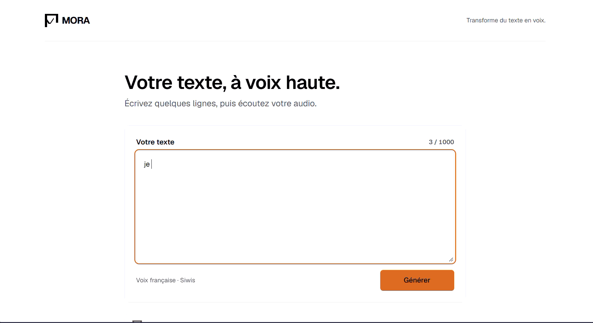
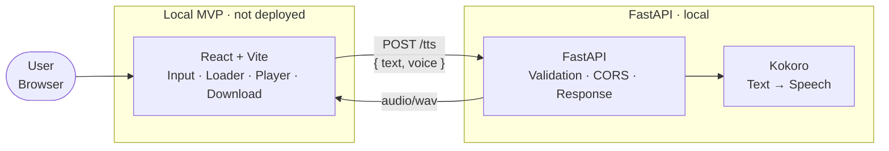

<div align="center">

[**English**](README.md) · [Français](README.fr.md)

# MORA

### Text to speech, in your browser.

Paste text. Generate a natural voice. Listen instantly. Download as WAV.<br/>
An open-source, full-stack AI application: React front end, FastAPI inference API, and the Kokoro TTS model. This is a local MVP; it has not yet been deployed.

[](LICENSE)
[](#roadmap)
[](#deployment)
[](https://react.dev)
[](https://fastapi.tiangolo.com)
[](https://huggingface.co/hexgrad/Kokoro-82M)

**Local MVP — not yet deployed** · [**Quick Start**](#quick-start) · [**API Reference**](#api-reference) · [**Roadmap**](#roadmap) · [**Contributing**](#contributing)

<br/>


</div>

<br/>

> [!NOTE]
> MORA currently runs locally and has not yet been deployed.

---

## Table of Contents

- [Overview](#overview)
- [Features](#features)
- [Quick Start](#quick-start)
- [Architecture](#architecture)
- [Tech Stack](#tech-stack)
- [Installation](#installation)
- [Configuration](#configuration)
- [Usage](#usage)
- [API Reference](#api-reference)
- [Project Structure](#project-structure)
- [Deployment](#deployment)
- [Security](#security)
- [Performance](#performance)
- [Testing](#testing)
- [Design Decisions](#design-decisions)
- [Roadmap](#roadmap)
- [Contributing](#contributing)
- [FAQ](#faq)
- [Support](#support)
- [License](#license)
- [Acknowledgements](#acknowledgements)

---

## Overview

Most TTS demos stop at a Python script. MORA ships the **entire chain**: product scoping, model selection, an isolated inference API, and a front end.

It is deliberately small, finished, and honest about its limits. It is not an ElevenLabs clone; it is a reference implementation of how to **serve an open-source model behind a clean contract** and put a real interface on top of it.

> *As a visitor, I want to paste French text, generate a voice, listen to it, and download it, without creating an account.*

| | |
|---|---|
| **No account** | Open the page and generate. No sign-up, no API key. |
| **No training** | Uses an evaluated open-source checkpoint instead of training from scratch. |
| **No lock-in** | Front end and API are decoupled. Point the front end to another API through `VITE_API_URL`. |
| **No cost** | The MVP currently runs locally; no hosting is configured. |

---

## Features

| Capability | Details |
|---|---|
| **French-first interface** | Full UI in French, built around a single, focused workflow |
| **Text-to-speech** | Kokoro open-source model, CPU inference, no custom training |
| **French voice** | The API supports `ff_siwis` |
| **Instant preview** | Native `<audio>` player, playback in the browser |
| **One-click download** | Export the result as a WAV file |
| **Input guardrails** | Server-enforced maximum text length to protect latency and CPU |
| **Clear feedback** | Loading state during inference and explicit error messages |
| **Decoupled architecture** | React front end and FastAPI communicate through a single endpoint |

### User flow

1. Enter or paste text.
2. Select **Générer**.
3. Wait for inference.
4. Listen to the result in the browser.
5. Download the audio file.

<div align="center">



</div>

---

## Quick Start

Run the full stack locally on Windows.

```powershell
git clone https://github.com/iamydgel/mora.git
cd mora
```

**Terminal 1: API**

```powershell
cd api
python -m venv .venv
.\.venv\Scripts\Activate.ps1
python -m pip install -r requirements.txt
uvicorn app.main:app --reload --host 127.0.0.1 --port 8000
```

**Terminal 2: Front end**

```powershell
cd frontend
Copy-Item .env.example .env # VITE_API_URL=http://127.0.0.1:8000
npm install
npm run dev
```

Open the URL printed by Vite (default `http://localhost:5173`), type some text, and select **Générer**.

---

## Architecture



| Layer | Responsibility | Runs on |
|---|---|---|
| **Front end** | UX, HTTP calls, playback, download | Local development server |
| **API** | Validation, inference orchestration, response format, CORS | Local Uvicorn server |
| **Model** | Text → speech | Loaded by the local API |
| **Auth / billing / object storage** | Out of scope for the MVP | n/a |

The front end and the API share a **single contract**: `POST /tts`. Point the front end to another API by changing `VITE_API_URL`, not by rewriting the product.

<div align="center">


</div>

---

## Tech Stack

| Layer | Technology | Rationale |
|---|---|---|
| Front end | [React](https://react.dev) + [Vite](https://vitejs.dev) | Industry standard, fast feedback loop, easy to read |
| HTTP | `fetch` + `Blob` | All a binary POST-and-play flow requires |
| API | [FastAPI](https://fastapi.tiangolo.com) | Typed, OpenAPI docs out of the box, native Python ML ecosystem |
| Model | [Kokoro](https://huggingface.co/hexgrad/Kokoro-82M) | Open source, strong quality-to-size ratio, realistic on CPU |

---

## Installation

### Prerequisites

| Tool | Version | Notes |
|---|---|---|
| Node.js | 20+ | Front end |
| Python | 3.10+ | API |
| espeak-ng | latest | Phonemizer dependency used by Kokoro for non-English text (`apt-get install espeak-ng`, `brew install espeak-ng`) |

### API

```powershell
cd api
python -m venv .venv
.\.venv\Scripts\Activate.ps1
pip install -r requirements.txt
uvicorn app.main:app --reload --host 127.0.0.1 --port 8000
```

Interactive OpenAPI docs are served by FastAPI at `http://localhost:8000/docs`.

### Front end

```powershell
cd frontend
Copy-Item .env.example .env
npm install
npm run dev
```

### API with Docker

Docker is not configured in this MVP; `api/Dockerfile` is not present.

---

## Configuration

The front end reaches the API through `VITE_API_URL` only. No URL is hard-coded.

### Environment variables

#### Front end (`frontend/.env`)

| Variable | Required | Example | Description |
|---|---|---|---|
| `VITE_API_URL` | Yes | `http://127.0.0.1:8000` | Base URL of the MORA API, without a trailing slash |

#### API (`api/.env`)

| Variable | Required | Default | Description |
|---|---|---|---|
| — | No | — | The API does not read `api/.env`; its checkpoint, voice, text limit, and CORS origins are set in code |

### Advanced configuration

- **API values.** The checkpoint, French language code, supported voice, text limit, and CORS origins are currently set in `api/app/main.py`.
- **Client timeout.** The front-end request timeout is 120 seconds to allow time for inference.
- **Build-time variables.** Vite reads `VITE_*` values at startup/build time. Restart Vite after changing `VITE_API_URL`.
- **Backend swap.** Any server that implements the [`POST /tts`](#api-reference) contract can replace the local API with no front-end changes.

---

## Usage

### From the web interface

1. Paste French text into the input field.
2. Select **Générer** and wait for the loader to complete.
3. Press play, then download the WAV file.

### From the command line

```powershell
curl.exe -X POST http://127.0.0.1:8000/tts -H "Content-Type: application/json" -d '{"text":"Bonjour, ceci est un test de synthèse vocale.","voice":"ff_siwis"}' --output mora.wav
```

### From JavaScript

```js
const response = await fetch(`${import.meta.env.VITE_API_URL}/tts`, {
  method: "POST",
  headers: { "Content-Type": "application/json" },
  body: JSON.stringify({
    text: "Bonjour, ceci est un test de synthèse vocale.",
    voice: "ff_siwis",
  }),
});

if (!response.ok) throw new Error(`TTS request failed (${response.status})`);

const audioUrl = URL.createObjectURL(await response.blob());
new Audio(audioUrl).play();
```

---

## API Reference

### `GET /health`

Returns `{"status":"ok"}` when the API is running.

### `POST /tts`

Synthesizes speech from text and returns a WAV file.

**Request**

```http
POST /tts
Content-Type: application/json
```

```json
{
  "text": "Bonjour, ceci est un test de synthèse vocale.",
  "voice": "ff_siwis"
}
```

| Field | Type | Required | Rules |
|---|---|---|---|
| `text` | `string` | Yes | Must be non-empty after trimming and no longer than 1000 characters after trimming |
| `voice` | `string` | No | Only `ff_siwis` is supported; defaults to `ff_siwis` when omitted |

**Response**

| Status | Content type | Meaning |
|---|---|---|
| `200 OK` | `audio/wav` | 24 kHz WAV binary body with `Content-Disposition: attachment; filename="mora.wav"` |
| `400 Bad Request` | `application/json` | Empty text, text over the length limit, or unknown voice |
| `422 Unprocessable Entity` | `application/json` | Missing or invalid request fields |
| `500 Internal Server Error` | `application/json` | Inference failure |

Error bodies follow FastAPI's standard `{ "detail": "..." }` envelope.

**CORS.** The API allows `http://localhost:5173` and `http://127.0.0.1:5173`.

> [!IMPORTANT]
> The API loads `hexgrad/Kokoro-82M` with the French language code (`f`) at startup. The only supported voice is `ff_siwis`.

---

## Project Structure

```text
mora/
├── README.md
├── LICENSE
├── frontend/                 # React + Vite application
│   ├── src/
│   ├── package.json
│   └── .env.example
├── api/                      # FastAPI + Kokoro inference service
│   ├── app/
│   ├── test_kokoro.py
│   ├── requirements.txt
│   └── .venv/                 # Local virtual environment, ignored by Git
└── docs/
    ├── screenshot.png
    ├── demo.gif
    └── architecture.png
```

A single repository keeps cloning, reviewing, and portfolio linking friction-free.

---

## Deployment

MORA is currently a local MVP and has not yet been deployed.

### 1. API: Hugging Face Space (Docker)

The API is not deployed. There is no `api/Dockerfile` or public API endpoint yet.

### 2. Front end: Vercel

The front end is not deployed; there is no public front-end URL yet.

> [!WARNING]
> Screenshot, demo, and architecture image paths are placeholders; those files are not present yet.

---

## Security

| Area | Measure |
|---|---|
| **Input validation** | Text is validated for presence and maximum length before inference |
| **Voice allow-list** | Only a closed list of voices is accepted; unknown values return `400` |
| **CORS** | Explicit allow-list: `http://localhost:5173` and `http://127.0.0.1:5173` |
| **Stateless API** | No accounts, no database, no object storage: nothing to leak |
| **Secrets** | No API keys are required. The front-end API URL uses `VITE_API_URL`; the API has no environment-variable configuration |
| **Abuse resistance** | Length caps bound per-request cost. Quotas and rate limiting are planned alongside authentication |

---

## Performance

MORA runs inference on **CPU** by design.

| Factor | Behavior |
|---|---|
| **Latency** | Scales with text length. Short inputs are fast; long inputs are slower than on GPU |
| **Startup** | The local API loads the Kokoro pipeline once when the application starts |
| **Payload size** | WAV is uncompressed, so files are larger than MP3 or Opus equivalents |
| **Mitigations** | Server-side length cap, generous client timeout, explicit loading state |

The MVP currently runs locally and has no hosted inference service.

---

## Testing

MORA can be tested locally through its single API contract.

From `api/`, run `python test_kokoro.py` to generate `sortie.wav` with the Kokoro smoke test.

**Smoke test the API**

```powershell
curl.exe -s -o mora.wav -w "%{http_code}`n" -X POST http://127.0.0.1:8000/tts -H "Content-Type: application/json" -d '{"text":"Bonjour","voice":"ff_siwis"}'
# Expected: 200 audio/wav
```

**Verify guardrails**

```powershell
# Empty text → 400
curl.exe -s -o NUL -w "%{http_code}`n" -X POST http://127.0.0.1:8000/tts -H "Content-Type: application/json" -d '{"text":""}'

# Unknown voice → 400
curl.exe -s -o NUL -w "%{http_code}`n" -X POST http://127.0.0.1:8000/tts -H "Content-Type: application/json" -d '{"text":"Bonjour","voice":"unknown"}'
```

**Front end**

Run `npm run dev`, then verify the loader, the player, the download, and the error messages for empty and over-length input.

Automated API tests and CI are tracked on the [roadmap](#roadmap).

---

## Design Decisions

| Decision | Rationale |
|---|---|
| **One finished journey over many half-built features** | Text → audio → listen → download, fully shipped, beats eight features at 40% |
| **Open-source model over a commercial API** | The goal is to learn to *serve* a model, not only to consume a key |
| **No training** | Time, GPU, and dataset quality are out of budget and off-purpose. Value lives in integration: serving, API contract, UI, deployment |
| **FastAPI next to the model** | Python inference stays close to the weights |
| **Monorepo** | Front end, API, and docs live in one project directory |
| **Single endpoint contract** | Keeps the front end and API separated around the generation request |

### Non-goals for this version

- Accounts, authentication, JWT
- Payments, Stripe, quotas
- Cloud history (object storage + database)
- Voice cloning (XTTS, OpenVoice, and similar)
- GPU, EC2, paid VPS, paid domain name

These are intentional boundaries, not omissions. They remain evolution paths. The finish line was a **demonstrable product**, not the start of a mini-SaaS.

### Known limitations

- CPU inference is slower than GPU, especially on long text.
- The MVP has not yet been deployed.
- Voice quality is that of Kokoro, not of a commercial service.
- The API currently supports only the French voice `ff_siwis` on `hexgrad/Kokoro-82M`.
- No cloud history and no user accounts.
- Intended for learning and demonstration, with no production SLA.

---

## Roadmap

**MVP**

- [x] Product scoping, architecture, $0 stack
- [x] Kokoro + FastAPI running locally
- [x] Minimal React front end (input, loader, player, download)
- [ ] GitHub monorepo and documentation
- [ ] Hugging Face Space (Docker) and Vercel deployment
- [ ] Screenshots, demo GIF, live links

**Next** *(still $0 where possible)*

- [ ] 2–3 clearly exposed voices in the UI
- [ ] History via `localStorage`
- [ ] Lightweight landing page within the same React app
- [ ] Retry logic and a dedicated cold-start message
- [ ] Automated API tests and CI
- [ ] Compressed output formats (MP3 / Opus)

**Vision** *(directional, not a delivery commitment)*

- Accounts with JWT in HttpOnly cookies
- Quotas and Stripe billing
- Object storage for generated audio
- Voice cloning, only on suitable compute

If budget or traffic ever justifies it, the front end ↔ API separation allows moving to GPU or dedicated infrastructure, adding authentication and history, and introducing premium tiers **without a rewrite**.

---

## Contributing

Contributions of every size are welcome: bug reports, voice quality feedback, UI polish, documentation, and code.

**Workflow**

1. Fork the repository and create a branch: `git checkout -b feat/short-description`.
2. Make a focused change. One concern per pull request.
3. Verify locally using the [Testing](#testing) steps.
4. Commit with [Conventional Commits](https://www.conventionalcommits.org) (`feat:`, `fix:`, `docs:`, `refactor:`).
5. Open a pull request describing the problem, the approach, and, for UI changes, a screenshot or short recording.

**Where help is most valuable**

- Validating French voices on the selected Kokoro checkpoint
- Cold-start handling and retry UX
- Automated tests and CI
- Accessibility and mobile polish
- Audio format and latency improvements

**Principles**

- Keep the API contract stable and backward compatible.
- Prefer small, readable changes over clever ones.
- Preserve the $0 local development path.

---

## FAQ

<details>
<summary><strong>Why is the first request slow?</strong></summary>

<br/>

MORA currently runs locally. The API loads the Kokoro pipeline when it starts; no Hugging Face Space is configured.

</details>

<details>
<summary><strong>Does MORA store my text or audio?</strong></summary>

<br/>

No. The API is stateless: it receives text, returns audio, and has no database or object storage.

</details>

<details>
<summary><strong>Can I use a different TTS model?</strong></summary>

<br/>

Yes. The front end only depends on the `POST /tts` contract. Replace the model inside the API, or replace the API entirely, and keep the same request and response shape.

</details>

<details>
<summary><strong>Can I host the API elsewhere?</strong></summary>

<br/>

The front end can point to another API that implements `POST /tts` by changing `VITE_API_URL`. Deployment instructions are not configured in this repository.

</details>

<details>
<summary><strong>Does MORA support voice cloning?</strong></summary>

<br/>

Not in this version. Cloning requires significantly more compute and storage and raises ethical considerations. It remains a long-term vision item, to be explored only with adequate infrastructure.

</details>

<details>
<summary><strong>Why not train a custom model?</strong></summary>

<br/>

Training demands GPU time and high-quality datasets, and it is not the point of this project. Starting from a model already evaluated by the community (for example on the Hugging Face TTS Arena) lets MORA focus on integration quality.

</details>

<details>
<summary><strong>Can I use the generated audio commercially?</strong></summary>

<br/>

The MORA code is MIT-licensed. Usage rights for generated audio depend on the license of the Kokoro checkpoint and voices you deploy. Review them before commercial use.

</details>

---

## Support

- **Bugs and feature requests:** open a [GitHub issue](https://github.com/iamydgel/mora/issues).
- **Feedback:** even one sentence on latency, voice naturalness, or a UI bug is valuable.
- **Questions about the architecture:** open an issue with the `question` label.

---

## License

MORA's source code is released under the [MIT License](LICENSE).

The **Kokoro** model is distributed under its own license, which governs the model weights and their usage, not the application code. Kokoro-82M is published under Apache 2.0; verify the license of the exact checkpoint you deploy.

---

## Acknowledgements

- [Kokoro](https://huggingface.co/hexgrad/Kokoro-82M) and its authors, for an open, efficient TTS model
- [Hugging Face](https://huggingface.co) for hosting the Kokoro checkpoint
- [FastAPI](https://fastapi.tiangolo.com), [React](https://react.dev), and [Vite](https://vitejs.dev)

---

<div align="center">

**Built by [iamydgel](https://github.com/iamydgel)**

A personal project, learning by building. Targeting the **Fullstack AI Engineer** profile: web product, model serving, and deployment.

If MORA is useful or instructive, consider giving it a ⭐

</div>
